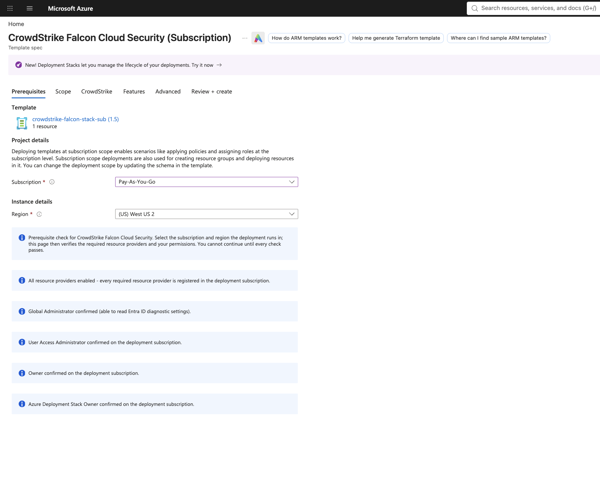
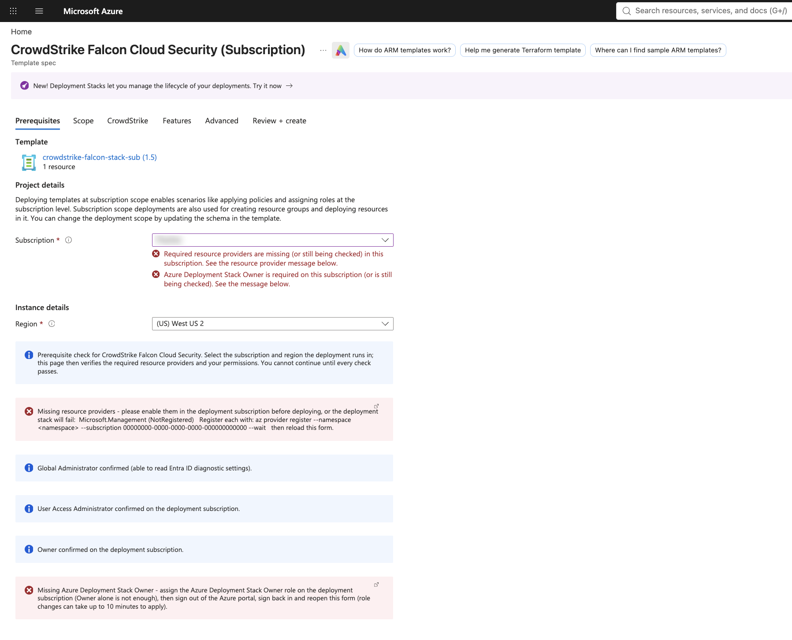
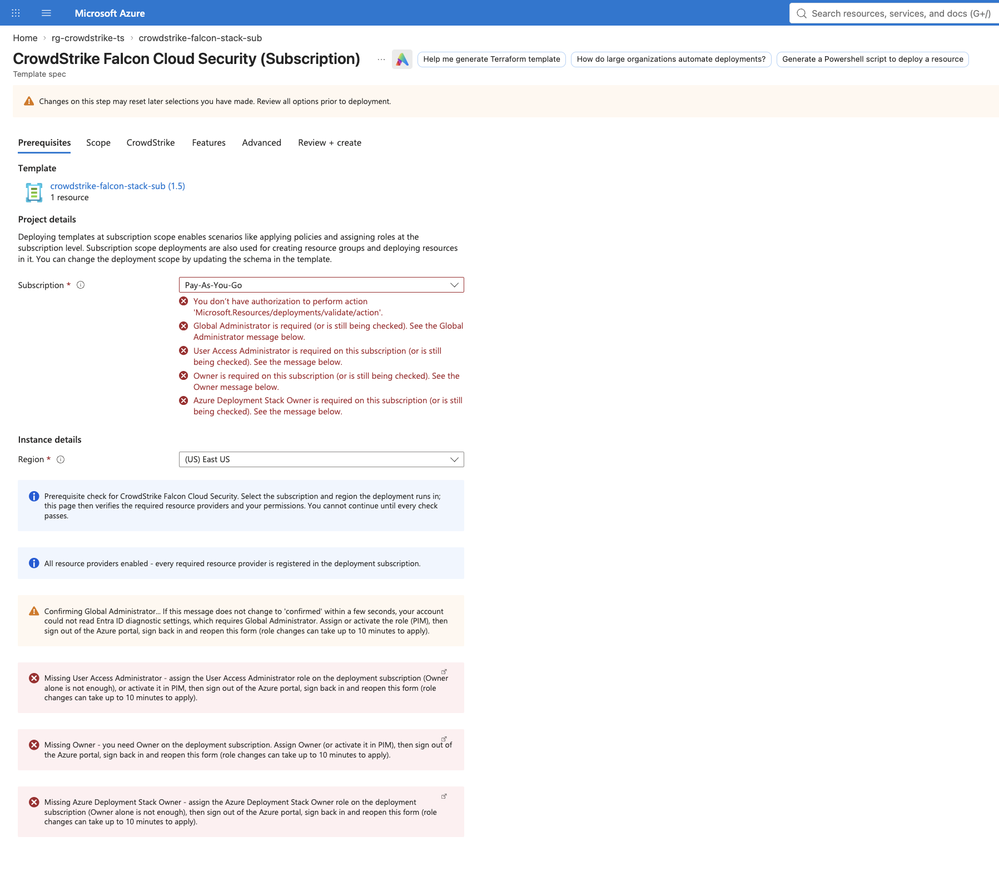

# CrowdStrike Falcon Cloud Security: Azure onboarding with a prerequisite checker

This repository onboards an Azure subscription or management group to CrowdStrike Falcon Cloud
Security through an Azure portal form. The form opens with a **Prerequisites** tab. It checks
that the deployment scope is ready and that the signed-in user holds the required roles, and it
won't let the user click **Next** until every check passes.

What gets deployed:

* **One ARM template per scope.** Its only resource is a `Microsoft.Resources/deploymentStacks`,
  and the CrowdStrike engine template is inlined into it at build time.
  * Subscription scope: `stacks/stackWrapper.inline.subscription.bicep`
  * Management-group scope: `stacks/stackWrapper.inline.managementGroup.bicep`
* **One portal form per scope**, in Form view (`uiFormDefinition`) format:
  * `ui/uiFormDefinition.templatespec.json`
  * `ui/uiFormDefinition.templatespec.managementGroup.json`

  These forms are generated by `scripts/form-checks/build_forms.py` from `ui/base/`. Don't edit
  them by hand.

The deployment stack owns every resource the engine creates, so updates and teardown are clean.

## Before you start: run the Falcon onboarding wizard first

This form **does not create the CrowdStrike enterprise application**. It deploys the Azure side
only and assigns roles to an application that must already exist in your Entra ID tenant. Neither
the form nor CrowdStrike's Bicep creates an app registration, a service principal or admin
consent; the engine only takes the principal's Object ID (`azurePrincipalId`) and assigns roles to it.

Do these in the Falcon console first (they match prerequisites 1 and 2 of CrowdStrike's Bicep
README in `crowdstrike-fcs-azure-bicep-generated/README.md`):

1. **Create the Azure registration in the Falcon onboarding wizard and grant admin consent** to the
   Falcon Cloud Security app. Consent is what creates the CrowdStrike **enterprise application**
   (`cs-app-…`) in your tenant.
   [US-1](https://falcon.crowdstrike.com/cloud-security/registration-v2/azure) ·
   [US-2](https://falcon.us-2.crowdstrike.com/cloud-security/registration-v2/azure) ·
   [EU-1](https://falcon.eu-1.crowdstrike.com/cloud-security/registration-v2/azure)
2. **Create a Falcon API client** with the `Cloud security Azure registration (Write)` scope. It's
   needed when real-time visibility, DSPM or vulnerability scanning is enabled.
3. Copy the enterprise application's **Object ID** (Entra ID → Enterprise applications →
   `cs-app-…` → Overview) and paste it on the form's **Scope** tab.

If the enterprise application is deleted and consent is granted again, it gets a **new Object
ID**. Use the current one, or the roles go to a principal that no longer exists. See
[Which ID the template expects](docs/prereq-checker.md).

## The prerequisite checker

Without the checker, a missing provider or role only shows up partway through the deployment, as
a failed deployment stack. The checker finds these problems before anything is deployed.

A form can't run code. The checker uses only what the portal gives a form:

1. Hidden `Microsoft.Solutions.ArmApiControl` elements call Azure Resource Manager (ARM)
   **as the signed-in user**.
2. `Microsoft.Common.InfoBox` elements show each result as checking, passed, or failed. Every
   failure says what's missing and how to fix it.
3. `constraints.validations` rules on the scope picker block **Next** while any check fails or
   is still running.

### What it checks (subscription scope)

| Check | How | Passes when |
|---|---|---|
| Resource providers | `GET /subscriptions/{id}/providers/{ns}`, once per provider: Microsoft.Management, ContainerInstance, Storage, Resources, Insights, PolicyInsights, EventHub | every provider is `Registered` |
| Global Administrator (**inferred**) | `GET /providers/microsoft.aadiam/diagnosticSettings` | the user can read Entra ID diagnostic settings |
| User Access Administrator | `GET .../providers/Microsoft.Authorization/permissions` | an entry has both `Microsoft.Authorization/*` and `*/read` |
| Owner | same call | an entry has `*` and no `notActions` |
| Azure Deployment Stack Owner | same call | an entry has `Microsoft.Resources/deploymentStacks/*` |
| Owner on monitored subscriptions (Scope tab) | one ARM `/batch` call across the "Subscriptions to monitor" list | Owner on each one (**not yet tested in the portal**) |

Each role is detected by an action list that only its built-in definition has. Owner alone
**doesn't** pass the User Access Administrator or Deployment Stack Owner checks. Forms can't call
Microsoft Graph, so Global Administrator is inferred: the check reads the same Entra ID resource
the template later writes. It isn't a role lookup.

### Management-group variant (tested at Tenant Root Group via Template Spec)

The management-group form runs the same kinds of checks against different scopes:

* Global Administrator, as above.
* User Access Administrator, Owner, and Azure Deployment Stack Owner on the selected management
  group.
* Resource providers and Owner on the **infrastructure subscription**.

All of its blocking rules are on the infrastructure-subscription picker.

### Screenshots

These screenshots come from the subscription-scope Template Spec in a lab tenant.
Subscription IDs are redacted.

**All checks passing.** Every result box is blue: resource providers registered, Global
Administrator confirmed, and User Access Administrator, Owner, and Azure Deployment Stack Owner
confirmed on the deployment subscription. **Next** is available.



**Two checks failing.** `Microsoft.Management` is `NotRegistered`, and the user lacks Azure
Deployment Stack Owner. Both failures appear in red under the subscription picker, which blocks
**Next**. The red boxes give the fix: the `az provider register` command, and which role to
assign before signing out and back in.



**A user with only Reader and no Entra ID admin role.** Providers pass. The Global Administrator
box stays amber ("Confirming…") because a denied lookup returns nothing the form can read.
User Access Administrator, Owner, and Stack Owner are all reported missing. The portal's own
check also reports the missing `Microsoft.Resources/deployments/validate/action` permission.



For the full design, see **[docs/prereq-checker.md](docs/prereq-checker.md)**. It covers how each
check works, why Owner doesn't count for the other roles, verification status, known limits, and
how to add a check.

## How to deploy

### Option A: Template Spec (verified)

This path has been verified end to end for subscription scope. The form appeared, the checks
ran, and the stack deployed successfully. Publish a Template Spec version into a resource group
you control, then deploy it from the portal (**Template specs** → *spec* → *version* →
**Deploy**).

```bash
# Subscription scope: builds forms + templates, then publishes. Use a version that doesn't exist yet.
bash scripts/create-templatespec-stack.sh    <RESOURCE_GROUP> <REGION> crowdstrike-falcon-stack-sub <VERSION>

# Management-group scope
bash scripts/create-templatespec-stack-mg.sh <RESOURCE_GROUP> <REGION> crowdstrike-falcon-stack-mg  <VERSION>
```

Both scripts need Azure CLI with Bicep and an `az login` session. Each one builds the forms
(`build_forms.py`), the engine JSON, and the wrapper JSON (in `dist/`, which is git-ignored),
then runs `az ts create` with `--ui-form-definition`. The portal asks *"Do you trust the
authors' code?"* because the form makes ARM calls. Choose **Yes**, or you get a generic form
without the checks.

### Option B: Deploy to Azure button (form loads from GitHub at both scopes; Create not yet run from a button)

> **Status: pending click-testing.** Nobody has clicked these buttons yet. They point at the
> `main` branch for the initial testing phase, and they can't work until the files in `deploy/`
> are committed to this public repository.

Microsoft's [deploy button article](https://learn.microsoft.com/azure/azure-resource-manager/templates/deploy-to-azure-button)
documents only `#create/Microsoft.Template/uri/<template>`. That format renders a **generic
parameter page with no prerequisite checks**.

To keep the checker, the button has to open the portal's custom-deployment blade with the same
Form view JSON the Template Spec uses:

```
https://portal.azure.com/#view/Microsoft_Azure_CreateUIDef/CustomDeploymentBlade
    /uri/<URL-encoded template URL>/uiFormDefinitionUri/<URL-encoded form URL>
```

This Form view URL format (`uiFormDefinitionUri`) is not in Microsoft's Deploy to Azure button
documentation. It's used in Microsoft's own public sample repositories:

* Azure Monitor Baseline Alerts: management-group scope
* Enterprise-Scale (Azure landing zones): tenant scope
* AVD Accelerator, Mission Landing Zone, and Container Apps Landing Zone Accelerator:
  subscription scope

Those forms use the same building blocks this checker uses (`ResourceScope`, `ArmApiControl`,
`InfoBox`, validations). Microsoft could change the blade without notice.

#### Generate the buttons

```bash
# Copy build output into deploy/ under stable names and scan it for IDs that must not go public
scripts/make-deploy-button.sh --stage

# Print the Markdown (both scopes; with-form and template-only variants)
scripts/make-deploy-button.sh https://raw.githubusercontent.com/mikedzikowski/cs-fcs-azure-onboarding-ui/main/deploy
```

#### Subscription scope

With the Prerequisites form (Form view):

[](https://portal.azure.com/#view/Microsoft_Azure_CreateUIDef/CustomDeploymentBlade/uri/https%3A%2F%2Fraw.githubusercontent.com%2Fmikedzikowski%2Fcs-fcs-azure-onboarding-ui%2Fmain%2Fdeploy%2FstackWrapper.subscription.json/uiFormDefinitionUri/https%3A%2F%2Fraw.githubusercontent.com%2Fmikedzikowski%2Fcs-fcs-azure-onboarding-ui%2Fmain%2Fdeploy%2FuiFormDefinition.subscription.json)

Without the prerequisite form (parameters only):

[](https://portal.azure.com/#create/Microsoft.Template/uri/https%3A%2F%2Fraw.githubusercontent.com%2Fmikedzikowski%2Fcs-fcs-azure-onboarding-ui%2Fmain%2Fdeploy%2FstackWrapper.subscription.json)

#### Management-group scope

With the Prerequisites form (Form view):

[](https://portal.azure.com/#view/Microsoft_Azure_CreateUIDef/CustomDeploymentBlade/uri/https%3A%2F%2Fraw.githubusercontent.com%2Fmikedzikowski%2Fcs-fcs-azure-onboarding-ui%2Fmain%2Fdeploy%2FstackWrapper.managementGroup.json/uiFormDefinitionUri/https%3A%2F%2Fraw.githubusercontent.com%2Fmikedzikowski%2Fcs-fcs-azure-onboarding-ui%2Fmain%2Fdeploy%2FuiFormDefinition.managementGroup.json)

Without the prerequisite form (parameters only):

[](https://portal.azure.com/#create/Microsoft.Template/uri/https%3A%2F%2Fraw.githubusercontent.com%2Fmikedzikowski%2Fcs-fcs-azure-onboarding-ui%2Fmain%2Fdeploy%2FstackWrapper.managementGroup.json)

#### Filling in the form

* **Scope tab:** enter the **Object ID** of the CrowdStrike enterprise application (its service
  principal in Entra ID), not its Application (client) ID.
* **Falcon IP addresses:** with real-time visibility on, the Features tab asks for the Falcon IP
  addresses (comma-separated) that the Event Hub firewall allows. They aren't stored in this repo,
  the same approach as CrowdStrike's Terraform module (`falcon_ip_addresses`). Get them from the
  "Allow CrowdStrike IP addresses" page for your Falcon cloud (Falcon login required):
  [US-1](https://docs.crowdstrike.com/access?ft:originId=ibc7ee4c),
  [US-2](https://docs.crowdstrike.com/access?ft:originId=a1f2fdef),
  [EU-1](https://docs.crowdstrike.com/access?ft:originId=yf3ab7b3).
* **Features tab:** the Falcon API client ID and client secret are shown, and required, only when
  real-time visibility, DSPM, or vulnerability scanning is enabled.
* **Advanced tab:** untick **Initial registration** when you're updating an existing
  registration.
* **Region reuse:** if the deployment fails with `InvalidDeploymentLocation`, an earlier
  deployment with the same name ran in a different region. Pick that earlier region (in our
  lab, West US for the management-group form).

#### What must be public for the button to work

The portal fetches the template and the form from the URLs in the link, so both must be publicly
readable. `dist/` is git-ignored, so `--stage` copies the release files into `deploy/`, which
must be **committed**:

| `deploy/` file | Built from |
|---|---|
| `stackWrapper.subscription.json` | `dist/stackWrapper.inline.subscription.json` |
| `uiFormDefinition.subscription.json` | `ui/uiFormDefinition.templatespec.json` |
| `stackWrapper.managementGroup.json` | `dist/stackWrapper.inline.managementGroup.json` |
| `uiFormDefinition.managementGroup.json` | `ui/uiFormDefinition.templatespec.managementGroup.json` |

The buttons above point at `main` for the initial testing phase. Once they're tested, pin them to
a **tag** instead, so each released template stays paired with the form it was tested with.

**Anything the button references is public.** These files must never contain CrowdStrike CIDs,
API client IDs or secrets, or tenant, subscription, management-group, or principal IDs. Users
enter those values in the form at deploy time; none of them are defaults in the template.
`--stage` refuses to continue if it finds:

* a GUID other than the Azure built-in role IDs the engine assigns
* a 32-hex string
* a 12-digit number
* key or SAS material

The forms contain the Falcon API host names but no Falcon IP addresses; users enter those on the
Features tab.

## Updating an existing deployment (new settings, or adding DSPM later)

Open the same form again (Template Spec or button), deploy it to the **same scope**, and click
**Create**. The wrapper creates the stack with a fixed name, so the same name means Azure
**updates** the existing stack in place rather than creating a second one:

* subscription: `<prefix>crowdstrike-falcon-<env><suffix>` (e.g. `crowdstrike-falcon-prod`)
* management group: `<prefix>crowdstrike-falcon-mg-<env><suffix>` (e.g. `crowdstrike-falcon-mg-prod`)

So keep **Environment**, **Resource name prefix** and **Resource name suffix** (Advanced tab)
the same as the first run. Change them and you get a new, separate stack.

Things to know:

* **Every run describes the whole desired state.** The form doesn't load the current
  settings, so re-enter everything: Object ID, Falcon cloud, features, Event Hub choice, Falcon IP
  addresses and API credentials. To add DSPM, tick DSPM *and* keep the features already on.
* **Removing a feature detaches its resources; it doesn't delete them.** The wrapper's
  `stackActionOnUnmanage` defaults to `detachAll`, and the form doesn't change it. Resources that
  leave the stack stay in Azure, unmanaged, until you delete them. (The Azure portal has no
  built-in way to update a stack: Microsoft lists it as not implemented. Re-running this form is the
  portal route.)
* **Untick Initial registration** (Advanced tab) when the tenant is already registered in Falcon.
  With real-time visibility on, the engine's callback script calls Falcon's
  `…/registrations/partial/v1` when the box is ticked and `…/registrations/v1` when it's unticked.
  In testing, two runs with the box ticked on an already-registered tenant failed with 409
  ("Registration status invalid"). A run after deleting the stack succeeded with it ticked. The
  exact rule isn't confirmed with CrowdStrike yet.
* **Use the same region as the first run.** A different region can fail with
  `InvalidDeploymentLocation`, because the engine's nested deployment names are reused.
* From the CLI, the equivalent is CrowdStrike's own `az stack sub|mg create` with the existing stack
  name (see the bundle README). It also prompts before overwriting.

## Repository layout

| Path | What it is |
|---|---|
| `crowdstrike-fcs-azure-bicep-generated/` | CrowdStrike engine (Bicep) |
| `stacks/` | deployment-stack wrappers |
| `ui/base/` | hand-written form tabs |
| `scripts/form-checks/` | check builders (`checks.py`) and form assembly (`build_forms.py`) |
| `ui/uiFormDefinition.templatespec*.json` | generated forms |
| `scripts/create-templatespec-stack*.sh` | build and publish a Template Spec |
| `scripts/make-deploy-button.sh` | stage release files and print Deploy-to-Azure buttons |
| `deploy/` | release files the Deploy to Azure buttons point at (from `make-deploy-button.sh --stage`) |
| `docs/` | design notes (start with `docs/prereq-checker.md`) |
