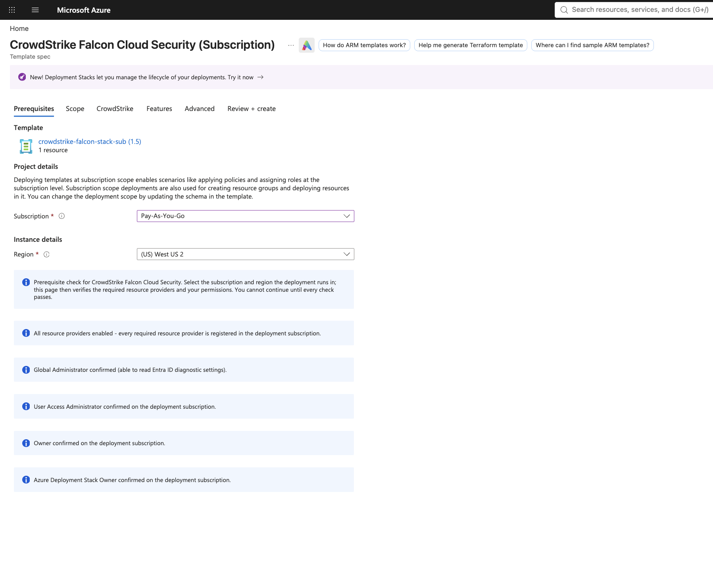
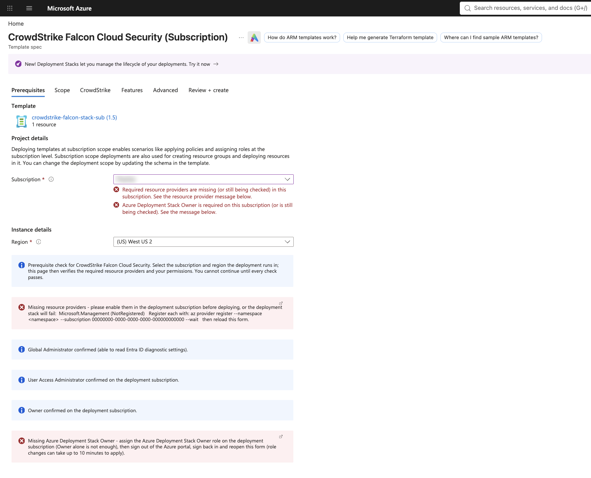
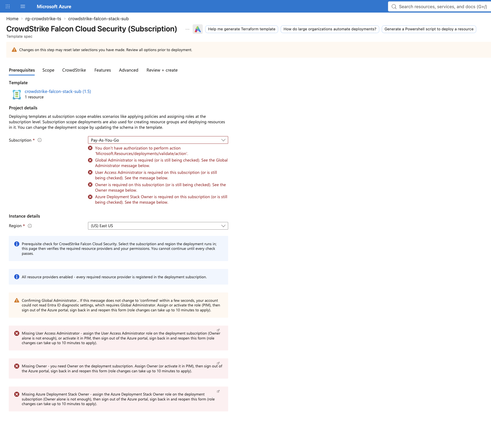

# Prerequisite checker: how it works

The CrowdStrike Falcon Cloud Security Template Spec opens with a **Prerequisites** tab. Before
the user can click **Next** or **Review + create**, it checks that the deployment subscription
has the required resource providers registered and that the signed-in user holds the required
roles. Every failure explains what's missing and how to fix it.

Without it, these problems show up mid-deployment as a failed deployment stack.

| All checks passing | Two checks failing (Next is blocked) |
|---|---|
|  |  |

A user with only Reader and no Entra admin role: GA unconfirmed, and UAA, Owner and Stack Owner all missing.



---

## 1. The pieces

```
 Template Spec  crowdstrike-falcon-stack-sub  (one version = one published build)
 ├── mainTemplate        dist/stackWrapper.inline.subscription.json
 │     └── Microsoft.Resources/deploymentStacks   ← the only resource
 │           └── template: CrowdStrike engine (inlined at build time)
 └── uiFormDefinition    ui/uiFormDefinition.templatespec.json
       ├── Prerequisites  ResourceScope + checks (blocks Next)
       ├── Scope          service principal, subscriptions to monitor (+ Owner check)
       ├── CrowdStrike    Falcon cloud, API client
       ├── Features       real-time visibility, DSPM, scanning
       └── Advanced       env, prefix/suffix
```

* **Template Spec**: a versioned template stored in an Azure resource group. One version holds
  a template and an optional portal form. "Deploy" in the portal renders the form and then runs
  the template.
* **uiFormDefinition (Form view)**: the portal form format used by Template Specs. It isn't
  `createUiDefinition.json`, which is the Managed Applications format. The two share most
  controls and expression functions, but they're different formats, and Microsoft documents
  separate element lists for each.
* **Deployment stack**: the template's only resource. The stack deploys the CrowdStrike engine
  and owns every resource it creates, which gives clean updates and teardown.

A form can't run code. It renders controls, calls Azure Resource Manager (ARM) through
`Microsoft.Solutions.ArmApiControl`, evaluates expressions, and refuses to continue while any
`constraints.validations` rule is false. The checker is built from those three things.

## 2. How one check works

Every check follows the same pattern:

```
 ArmApiControl (hidden)          InfoBoxes (visible)                    Validation (blocking)
 GET <ARM API> as the user  ──►  "checking…"  shown while no result  ──►  isValid on the
                                 "confirmed"  shown when it passes         ResourceScope
                                 "Missing …"  shown when it fails          subscription picker
```

1. **Query.** A hidden `ArmApiControl` calls an ARM API **as the signed-in user**. Its
   `request.path` includes the selected subscription, so picking a different subscription
   runs the query again.
2. **Report.** Up to three `Microsoft.Common.InfoBox` elements read the response. Each one's
   `visible` expression is true in exactly one state: checking, passed or failed. The failure
   box says what's missing, gives the fix, and links to Microsoft's docs.
3. **Block.** The same pass expression is added as an `isValid` rule on the subscription
   picker. While any rule is false, the portal shows the message under the picker and won't
   leave the tab. **Still checking counts as failing**, so nobody can click through before
   the lookups return.

One function in `scripts/form-checks/checks.py` builds the box and its blocking rule from the
same expression, so they can't disagree.

## 3. The checks

All checks run against the **deployment subscription** selected on the Prerequisites tab.

| Check | API call (as the user) | Passes when | Why it's required |
|---|---|---|---|
| Resource providers | `GET /subscriptions/{id}/providers/{namespace}` × 7 | every `registrationState` is `Registered` | ARM doesn't auto-register providers for resources it creates indirectly (deployment scripts create a container instance and storage account). CrowdStrike's registration guide lists them as prerequisites. |
| Global Administrator | `GET /providers/microsoft.aadiam/diagnosticSettings` | the response has a `value` | The template creates an Entra ID diagnostic setting. CrowdStrike's guide requires Global Administrator (or Security Administrator) for that. |
| User Access Administrator | `GET /subscriptions/{id}/providers/Microsoft.Authorization/permissions` | an entry contains both `Microsoft.Authorization/*` and `*/read` | Customer requirement: the role must be assigned itself. Owner doesn't count. |
| Owner | same call as above | an entry has `actions: ["*"]` with no `notActions` | CrowdStrike's guide requires Owner on the deployment scope. |
| Azure Deployment Stack Owner | same call as above | an entry contains `Microsoft.Resources/deploymentStacks/*` | CrowdStrike's guide requires this role on the stack's scope, assigned separately. Owner alone isn't enough. |

The seven providers are Microsoft.Management, ContainerInstance, Storage, Resources, Insights,
PolicyInsights and EventHub.

On the **Scope** tab, a further check confirms **Owner on every subscription in "Subscriptions
to monitor"**, using one ARM `/batch` call. It blocks Next on that tab.

### How a role is detected

Forms can only call ARM. They can't call Microsoft Graph or list role *names* for the user.
The permissions API returns the user's **effective permissions**: one entry per role
assignment, including assignments through groups and assignments inherited from management
groups or tenant root. Each role is recognized by an action list that only its built-in
definition has:

| Role | Its built-in definition | What the check looks for |
|---|---|---|
| Owner | `actions: ["*"]` | `*` with empty `notActions` |
| User Access Administrator | `["*/read", "Microsoft.Authorization/*", "Microsoft.Support/*"]` | both `Microsoft.Authorization/*` and `*/read` |
| Azure Deployment Stack Owner | `[…, "Microsoft.Resources/deploymentStacks/*", …]` | `Microsoft.Resources/deploymentStacks/*` |

So **Owner doesn't satisfy the UAA or Stack Owner checks**: its only action is `*`, which
contains neither string. **Azure Deployment Stack Contributor** doesn't pass either: it lists
individual stack actions, not `deploymentStacks/*`. The "Elevate access" toggle assigns UAA at
tenant root, which every subscription inherits, so it passes the UAA check.

A custom role that copies one of these action lists would also pass.

### Why Global Administrator is inferred

Entra ID roles live in Microsoft Graph, and forms can't call Graph. The check reads the tenant's
Entra ID diagnostic settings instead. That's the same resource the template later writes, and
the same permission boundary CrowdStrike's requirement is about. It's an inference, not a role
lookup.

### Which ID the template expects for the CrowdStrike app

The Scope tab asks for `azurePrincipalId`. The CrowdStrike engine defines it as
"Principal ID of the CrowdStrike application registered in Entra ID. This ID is used for role
assignments and access control" (`cs-deployment-subscription.bicep`,
`cs-deployment-management-group.bicep`). Every module passes it straight into a role
assignment:

```bicep
resource roleAssignments 'Microsoft.Authorization/roleAssignments@2022-04-01' = {
  name: guid(azurePrincipalId, roleDefinitionId, subscription().id, env)
  properties: {
    principalId: azurePrincipalId
    principalType: 'ServicePrincipal'
  }
}
```

(`modules/asset-inventory/roleAssignmentToSub.bicep`, `roleAssignmentToMgmtGroup.bicep`,
`modules/log-ingestion/eventHubRoleAssignment.bicep`. The scanning modules get the same value as
`scanningPrincipalId`.)

So the value must be **the Object ID of the CrowdStrike enterprise application (service
principal)** in the customer tenant:

| ID on the app | Use it? | Why |
|---|---|---|
| **Object ID** (Entra ID → Enterprise applications → `cs-app-…` → Overview) | ✅ | It identifies the service principal, which is what `principalId` + `principalType: 'ServicePrincipal'` means |
| Application (client) ID (same page) | ❌ | It identifies the app across all tenants, not the principal in this tenant |
| App registration Object ID | n/a | The CrowdStrike app is multi-tenant: the customer tenant has only the enterprise application, with no app registration |

CLI: `az ad sp list --display-name <cs-app name> --query "[].id" -o tsv`

**What the template doesn't do:** it never checks the value. A wrong or stale ID deploys
"successfully": ARM creates role assignments for a principal that doesn't exist, and they
grant nothing. Because the assignment name is derived from the ID (`guid(azurePrincipalId, …)`),
a corrected ID creates *new* assignments and leaves the old ones orphaned.

**The Object ID changes if the enterprise application is deleted and re-consented** (for example
by re-running admin consent). The Application ID stays the same, which makes this easy to miss.
This happened in testing on 2026-11-03: the MG deployment used the pre-deletion Object ID, the
CrowdStrike app got no roles, and Falcon couldn't complete validation.

**How the form makes the ID visible:**

1. **Entry.** The label and the help box say which ID to use, and how to find it.
2. **Echo.** Under the field, the form shows "Azure roles will be assigned to principal ID
   `<value>`", to compare against the enterprise application's Overview page.
3. **After deployment.** To confirm which principal the stack actually used, and that it's
   the current one:

```bash
# ID the stack was deployed with
az stack mg show  --management-group-id <mg> -n <stack> --query parameters.azurePrincipalId.value -o tsv
az stack sub show -n <stack> --query parameters.azurePrincipalId.value -o tsv
# Current Object ID of the CrowdStrike enterprise app; must match the line above
az ad sp list --display-name <cs-app name> --query "[].id" -o tsv
# Roles that principal holds
az role assignment list --assignee-object-id <object-id> --all -o table
```

## 4. Form layout requirements

The subscription-scope form must start with a `Microsoft.Common.ResourceScope` named
`resourceScope`: first element of the first step. The portal builds the deployment's
subscription and location from it. The published schema only allows `ResourceScope` in that
position, and the form view sandbox generates exactly that layout for a subscription-scope
template.

The deployment context in `view.outputs` then reads:

```json
"kind": "Subscription",
"subscriptionId": "[steps('basics').resourceScope.subscription.id]",
"location":       "[steps('basics').resourceScope.location.name]"
```

All five Prerequisites validations are attached to `resourceScope.subscription.constraints`.

## 5. Build and publish

Never edit the form under `ui/` directly; the build regenerates it.

```
 ui/base/uiFormDefinition.templatespec*.json     hand-written tabs (CrowdStrike, Features, …)
 scripts/form-checks/checks.py                   check builders (query + boxes + validation)
 scripts/form-checks/build_forms.py              assembles Prerequisites + Scope, rewires outputs
        │
        ▼
 ui/uiFormDefinition.templatespec*.json          generated forms
        │
 scripts/create-templatespec-stack.sh  RG  REGION  SPEC_NAME  VERSION
   [0] build forms   [1] build engine JSON   [2] build wrapper (engine inlined)
   [3] ensure RG     [4] az ts create --template-file … --ui-form-definition …
```

The build script keeps every element it doesn't change byte-for-byte as written in `ui/base/`,
and serializes only the generated parts.

To publish a new version (use a version number that doesn't exist yet):

```bash
bash scripts/create-templatespec-stack.sh rg-crowdstrike-ts westus2 crowdstrike-falcon-stack-sub 1.6
```

To try a form without publishing, paste the built JSON into the
[form view sandbox](https://aka.ms/form/sandbox) and click **Preview**.

## 6. What the user sees

1. **Do you trust the authors' code?** The portal asks this for any Template Spec form that
   makes ARM calls. **Yes** loads the real form; **No** falls back to a generic one without
   the checks.
2. **Prerequisites.** Pick the subscription and region. Each check moves from "checking…" to
   "confirmed" or "Missing …".
3. **Fix and retry.** For provider failures, the message gives the `az provider register`
   command; register, then reload. For role failures, assign or activate (PIM) the role, then
   **sign out of the portal and back in**. The form reads the session's permissions, and
   Microsoft documents up to 10 minutes for role changes to take effect, with sign-out/in
   forcing a refresh.
4. **Scope → CrowdStrike → Features → Advanced → Review + create → Create.** The deployment
   creates the stack, and the stack deploys the CrowdStrike resources.

## 7. Verification status

| Behavior | Status |
|---|---|
| Provider check: green, and red with `Microsoft.Management (NotRegistered)` | ✅ seen in the portal |
| UAA check: passes only with the UAA role (after sign-out/in) | ✅ seen in the portal |
| Owner check | ✅ seen in the portal |
| Stack Owner check: red without the role, green after assigning it | ✅ seen in the portal |
| Global Administrator check passes for a GA | ✅ seen in the portal |
| Next / Review + create blocked while any check fails | ✅ seen in the portal |
| End-to-end deployment from the form (stack `succeeded`, 12 managed resources, Event Hub firewall limited to the Falcon cloud's IPs) | ✅ deployed 2026-11-02 |
| Global Administrator check for a **non-GA** user | ✅ seen in the portal: the amber "Confirming Global Administrator…" box stays up and Next is blocked. The red "Missing Global Administrator" box never appears, because a denied lookup doesn't return an `error` the form can read |
| Owner check on monitored subscriptions (`/batch`) | ⚠️ not yet tested (`/batch` didn't work for the GA check in the portal) |
| Management-group form | ⚠️ never published |

## 8. Known limits

* **Global Administrator is inferred** (section 3). Roles that can read Entra ID diagnostic
  settings may also pass. CrowdStrike accepts Security Administrator for this step.
* **Only the deployment subscription is checked for providers.** CrowdStrike's guide needs
  Microsoft.Insights in every registered subscription.
* **The monitored-subscription check is limited to one tenant, at most 20 subscriptions, no
  duplicates** (ARM `/batch` limits).
* **Re-checks need a reload.** Forms don't poll, so after fixing something the user reloads the
  form, or signs out and in for role changes.
* **Region.** A redeploy must use the region of any existing deployment records with the same
  names. ARM rejects reusing a deployment name in a different location (`InvalidDeploymentLocation`).

## 9. Lessons from building it

| Problem | Cause | Fix |
|---|---|---|
| `'location' property must be specified` at Create | the form had a plain subscription picker, no `ResourceScope` | `ResourceScope` as the first element; outputs read from it |
| `Unexpected token '\' … is not valid JSON` | a `parse('…')` literal was double-escaped | build literals with `json.dumps`, and test them with a strict JSON parse |
| GA check broke when routed through ARM `/batch` | `/batch` gave no usable result inside the portal | plain `GET` |
| "Owner covers UAA / Stack Owner" | an assumption; CrowdStrike's guide requires Stack Owner separately | detect each role by its own action list |
| UAA still "missing" right after enabling it | the portal session still had the old permissions | sign out and back in (Microsoft's elevate-access doc) |

## 10. Extending it

To add a provider, add `("rpX", "Microsoft.X")` to `NAMESPACES` in `checks.py`.

To add a role check:

1. Add the action-list condition to `has` in `permissions()`, with its pass and fail text.
2. Add its key to the `checks=` list in `build_forms.py`.
3. Add its `isValid` rule to `resourceScope.subscription.constraints.validations`.

Then run `python3 scripts/form-checks/build_forms.py`, preview the result in the sandbox, and
publish a new version.

## References

* CrowdStrike: *Register Your Azure Environment Using Bicep* (prerequisites and required
  permissions); *Allow CrowdStrike IP Addresses*; *Troubleshoot a Missing Deployment Stack*.
* Microsoft Learn: [Form view overview](https://learn.microsoft.com/azure/azure-resource-manager/templates/form-view-overview),
  [Form view elements](https://learn.microsoft.com/azure/azure-resource-manager/templates/form-view-elements),
  [ResourceScope](https://learn.microsoft.com/azure/azure-resource-manager/templates/form-view-microsoft-common-resourcescope),
  [ArmApiControl](https://learn.microsoft.com/azure/azure-resource-manager/managed-applications/microsoft-solutions-armapicontrol),
  [Create portal forms for a Template Spec](https://learn.microsoft.com/azure/azure-resource-manager/templates/template-specs-create-portal-forms),
  [Deployment stacks](https://learn.microsoft.com/azure/azure-resource-manager/bicep/deployment-stacks),
  [Resource providers](https://learn.microsoft.com/azure/azure-resource-manager/management/resource-providers-and-types),
  [Troubleshoot Azure RBAC](https://learn.microsoft.com/azure/role-based-access-control/troubleshooting),
  [Elevate access for a Global Administrator](https://learn.microsoft.com/azure/role-based-access-control/elevate-access-global-admin).
